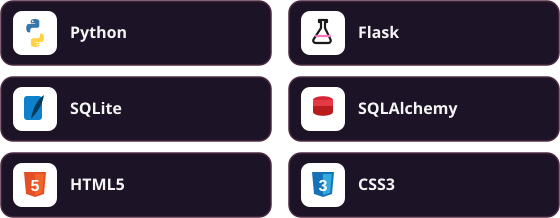

  

# Veruska Rafaelly

# Veruska Rafaelly

**Estudante de Ciência da Computação na Estácio (5º semestre) · Instrutora de Informática & Estagiária de TI**

Crio aplicações web, ferramentas de análise e dashboards interativos que conectam software, IA e dados.

Trabalho com Python, SQL, Flask, Power BI e Excel. Defino a estrutura, a direção visual e as prioridades dos projetos, usando IA como apoio à implementação e à revisão. Meu foco é transformar dados e ideias em soluções funcionais, com atenção à clareza, à usabilidade e aos detalhes.

  
  
  

 

---

## Projetos em destaque

### 01 / Fake Pinterest

Aplicação web inspirada no Pinterest para compartilhamento de imagens, com sistema de contas, perfis de usuário e feed dinâmico.

* **Recursos:** cadastro e login de usuários, upload de fotos e gerenciamento de perfil.
* **Repositório:** [veruskarafaelly/Projeto-FakePinterest](https://github.com/veruskarafaelly/Projeto-FakePinterest)

 

---

## Tecnologias e ferramentas

### Desenvolvimento

  

No **Fake Pinterest**, desenvolvi o back-end em **Python** com **Flask**, estruturando rotas, autenticação de usuários e upload de imagens. Usei **SQLite** e **SQLAlchemy** para o banco de dados relacional e **HTML5** com **CSS3** para as páginas de feed e perfil.

 

---

## Contato

* **LinkedIn:** [Veruska Rafaelly](https://linkedin.com)
* **GitHub:** [@veruskarafaelly](https://github.com/veruskarafaelly)
